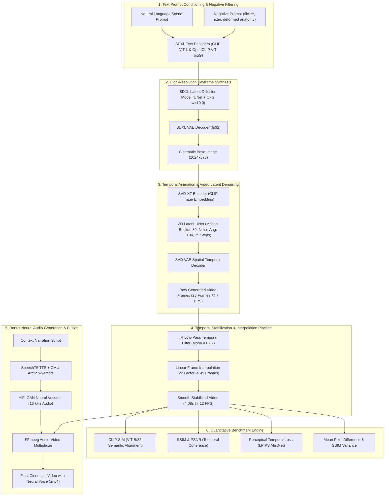

# 🎬 Daily Cinematic Video Generator: Diffusion-Based Movie Clip Synthesis

[](https://www.python.org/)
[](https://pytorch.org/)
[](https://github.com/huggingface/diffusers)
[](https://developer.nvidia.com/cuda-zone)
[](https://github.com/)
[](LICENSE)

An end-to-end generative artificial intelligence framework designed to synthesize temporally consistent, high-fidelity cinematic video clips depicting human motion in dynamic urban environments. Combining **Stable Diffusion XL (SDXL)** for text-conditioned keyframe rendering, **Stable Video Diffusion (SVD-XT)** for latent temporal animation, **First-Order IIR Temporal Smoothing** to eliminate inter-frame flicker, and **Neural SpeechT5** for context-synchronized voiceover narration.

---

## 📑 Table of Contents

- [Executive Summary](#-executive-summary)
- [System Architecture](#-system-architecture)
- [Key Features](#-key-features)
- [Phased Research & Development](#-phased-research--development)
  - [Phase 1: Generative Foundation & Systematic Profiling](#phase-1-generative-foundation--systematic-profiling)
  - [Phase 2: Algorithmic Enhancements & Ablation Experiments](#phase-2-algorithmic-enhancements--ablation-experiments)
  - [Bonus Module: Neural Speech-to-Video Synchronization](#bonus-module-neural-speech-to-video-synchronization)
- [Quantitative Benchmark & Empirical Evaluation](#-quantitative-benchmark--empirical-evaluation)
  - [Phase 2 Ablation Study Results](#phase-2-ablation-study-results)
  - [Phase 1 Parameter Exploration Results](#phase-1-parameter-exploration-results)
  - [Evaluation Metrics Formulation](#evaluation-metrics-formulation)
- [Repository Structure](#-repository-structure)
- [Getting Started](#-getting-started)
  - [Prerequisites](#prerequisites)
  - [Installation](#installation)
  - [Quickstart: Generate Cinematic Video](#quickstart-generate-cinematic-video)
  - [Running the Research Notebooks](#running-the-research-notebooks)
- [Hyperparameter & Configuration Guide](#-hyperparameter--configuration-guide)
- [Qualitative Human User Study](#-qualitative-human-user-study)
- [Limitations & Ethical Considerations](#-limitations--ethical-considerations)
- [References & Acknowledgments](#-references--acknowledgments)

---

## 🌟 Executive Summary

Generating realistic short video clips from natural language descriptions presents two major challenges:
1. **Semantic Fidelity:** Ensuring the generated scene, characters, lighting, and camera perspective strictly match complex text conditioning.
2. **Temporal Coherence:** Eliminating high-frequency flicker, structural morphing, and anatomical degradation across consecutive frames.

This project addresses these challenges through a two-phase research methodology:
- **Phase 1 (Baseline & Diagnostic Profiling):** Establishes an SDXL + SVD generative baseline and performs multi-variable sensitivity studies (Classifier-Free Guidance, Denoising Steps, and Scene Complexity). Automated heuristics revealed that while semantic alignment was consistently high ($CLIP\text{-}SIM > 32.0$), temporal consistency degraded significantly in crowded scenes (mean SSIM dropped to $0.590$ with high frame-to-frame pixel variance).
- **Phase 2 (Targeted Algorithmic Optimization):** Implements dual targeted enhancements:
  - **Enhancement A (Semantic Prompt Engineering & CFG Scaling):** Eliminates anatomical distortions and stabilizes contextual tokens ($w=10.0$ CFG + curated negative constraints).
  - **Enhancement B (Temporal Stabilization & Low-Pass Filtering):** Combines motion bucket damping, an exponential IIR temporal smoothing filter ($\alpha = 0.82$), and linear interpolation to expand playback duration to $4.08\text{ s}$ at $12\text{ FPS}$.
  - **Combined Model (A + B):** Elevates mean SSIM from $0.705 \rightarrow 0.947$, improves PSNR from $16.45\text{ dB} \rightarrow 28.49\text{ dB}$, drops perceptual temporal loss ($LPIPS$) by $78.1\%$, and reduces mean frame difference from $20.00 \rightarrow 3.95$.
- **Bonus System (Neural Audio-Visual Synergy):** Integrates **Microsoft SpeechT5 TTS** paired with **HiFi-GAN** neural vocoders and speaker embeddings to synthesize contextual voice narration, multiplexed into the final video via FFmpeg.

---

## 🏛 System Architecture

The end-to-end generation and evaluation pipeline operates across four coordinated stages:



---

## ✨ Key Features

- **Dual-Stage Diffusion Pipeline:** Employs Stable Diffusion XL 1.0 for high-fidelity spatial details and Stable Video Diffusion XT for smooth inter-frame dynamics.
- **Mathematical Temporal Filtering:** Eliminates high-frequency frame flicker using recursive exponential smoothing without requiring heavy model re-training.
- **Duration Expansion:** Employs linear intermediate frame synthesis to reach compliant cinematic durations ($>4.0\text{ seconds}$).
- **Automated Heuristic Weakness Engine:** Analyzes frame-to-frame SSIM variance, mean absolute differences, and CLIP text-image logits to categorize output quality as *good*, *moderate*, or *poor*.
- **Comprehensive Ablation Framework:** Fully isolated benchmarking comparing Baseline, Enhancement A, Enhancement B, and Combined configurations across identical seeds.
- **Multi-Voice Neural Narration:** Incorporates Microsoft SpeechT5 text-to-speech with CMU Arctic speaker embeddings and emotion/style presets (Neutral, Happy, Calm).
- **Production-Ready Scripts:** Includes compact, self-contained Python scripts for instant execution and reproducibility.

---

## 🔬 Phased Research & Development

### Phase 1: Generative Foundation & Systematic Profiling

Phase 1 established the baseline text-to-video workflow and executed systematic parameter sweeps across three dimensions:

1. **Experiment A: Guidance Scale Sensitivity ($w \in \{5.0, 7.5, 10.0\}$)**
   - Evaluated the influence of Classifier-Free Guidance on base image structure and subsequent video generation.
   - *Observation:* Higher guidance ($w = 10.0$) enhanced subject-background separation and raised mean SSIM to $0.782$, without deteriorating generation throughput.
2. **Experiment B: Image-to-Video Denoising Steps ($N \in \{15, 25, 40\}$)**
   - Profiled computational cost vs. perceptual stability.
   - *Observation:* 25 steps provided optimal cost-performance balance ($365\text{ s}$ per run). 40 steps yielded diminishing returns ($547\text{ s}$) with marginal SSIM variation ($0.756$).
3. **Experiment C: Scene Complexity & Motion Dynamics**
   - Contrasted three prompt difficulties: Simple (isolated pedestrian on sunlit street), Medium (pedestrian on bustling urban road with moving traffic), and Complex (chaotic multi-agent marketplace).
   - *Observation:* Increasing scene complexity triggered severe temporal degradation:
     - Simple Scene: Mean SSIM = $0.802$, Frame Diff = $8.99$, Temporal Quality: Moderate.
     - Complex Scene: Mean SSIM = $0.590$, Frame Diff = $24.04$, Temporal Quality: **Poor (severe flickering detected)**.

> **Key Diagnostic Takeaway:** Phase 1 achieved excellent semantic alignment ($CLIP\text{-}SIM \approx 32.0\text{--}33.5$), but suffered from temporal instability and flicker, establishing the precise mandate for Phase 2.

---

### Phase 2: Algorithmic Enhancements & Ablation Experiments

To systematically resolve Phase 1 weaknesses, Phase 2 formulated and validated two complementary improvements:

#### 1. Enhancement A: Semantic Conditioning & CFG Formulation
Classifier-Free Guidance directs the diffusion sampling trajectory according to:

$$\hat{\epsilon}_\theta(x_t, c) = \epsilon_\theta(x_t, \emptyset) + w \cdot \left(\epsilon_\theta(x_t, c) - \epsilon_\theta(x_t, \emptyset)\right)$$

Where:
- $c$: Context conditioning vector generated by the dual text encoders.
- $\emptyset$: Unconditioned null prompt.
- $w$: Guidance scale ($w = 10.0$).

In addition to scaled CFG, explicit positive descriptors (anatomical coherence, stable lighting, steady camera tracking) and negative prompts (flicker, jitter, low quality, duplicate limbs, warped facial geometry) were integrated into the conditioning pipeline.

#### 2. Enhancement B: Motion Damping & Temporal IIR Filtering
To suppress camera shake and object morphing:
1. SVD motion bucket was damped from $127 \rightarrow 80$, and noise augmentation strength was reduced from $0.10 \rightarrow 0.04$.
2. An online first-order Infinite Impulse Response (IIR) low-pass filter was applied to sequential decoded RGB frames:

$$\tilde{I}_t = \alpha I_t + (1 - \alpha) \tilde{I}_{t-1}, \quad \text{with } \alpha = 0.82$$

Where $I_t$ is the raw decoded SVD frame and $\tilde{I}_t$ is the smoothed frame. High-frequency flicker is suppressed while preserving genuine human walking kinematics.
3. Linear interpolation was applied with an expansion factor of $2\times$, doubling frame count from $25 \rightarrow 49$ frames and increasing playback rate to $12\text{ FPS}$ ($4.08\text{ seconds}$ duration).

#### 3. Combined Pipeline (A + B)
Unifies prompt conditioning, negative artifact rejection, motion damping, temporal low-pass smoothing, and frame interpolation.

---

### Bonus Module: Neural Speech-to-Video Synchronization

To provide a fully realized multimedia asset, an optional bonus text-to-audio subsystem was integrated:
- **TTS Engine:** `microsoft/speecht5_tts` sequence-to-sequence neural architecture.
- **Vocoder:** `microsoft/speecht5_hifigan` GAN-based neural vocoder operating at $16\text{ kHz}$.
- **Speaker Profile:** CMU Arctic x-vector embeddings (`Matthijs/cmu-arctic-xvectors`, Voice 1).
- **Prosody Modulation:** Text chunking by punctuation marks with parameterized pause insertion and pitch normalization.
- **Audio-Video Muxing:** Lossless stream multiplexing using FFmpeg with AAC audio encoding.

---

## 📊 Quantitative Benchmark & Empirical Evaluation

All benchmarks were evaluated under identical hardware conditions (NVIDIA Tesla T4 GPU, FP16 precision, PyTorch 2.x, Fixed Seed = 4096).

### Phase 2 Ablation Study Results

The 4-way ablation isolates the individual and joint effects of each enhancement:

| Variant | Guidance Scale ($w$) | Motion Bucket | Temporal Smoothing | Interpolation | Duration (s) | Mean SSIM ↑ | Mean PSNR (dB) ↑ | Mean Frame Diff ↓ | LPIPS Temporal ↓ | CLIP-SIM ↑ | Temporal Consistency |
| :--- | :---: | :---: | :---: | :---: | :---: | :---: | :---: | :---: | :---: | :---: | :---: |
| **Baseline** | 7.5 | 127 | No | No | 3.57s | 0.7049 | 16.45 dB | 19.999 | 0.2033 | **34.22** | Moderate (flicker) |
| **Enhancement A** | **10.0** | 127 | No | No | 3.57s | 0.8064 | 20.08 dB | 10.172 | 0.0967 | 33.80 | Moderate |
| **Enhancement B** | 7.5 | **80** | **Yes ($\alpha=0.82$)** | **Yes ($2\times$)** | **4.08s** | **0.9567** | 27.93 dB | 4.496 | **0.0438** | **34.95** | **Good (stable)** |
| **Combined (A + B)** | **10.0** | **80** | **Yes ($\alpha=0.82$)** | **Yes ($2\times$)** | **4.08s** | **0.9466** | **28.49 dB** | **3.954** | **0.0445** | 33.65 | **Good (stable)** |

#### 📈 Key Quantitative Observations:
1. **SSIM Enhancement:** Combined (A+B) achieves a **+0.242 gain in SSIM** ($0.705 \rightarrow 0.947$) and a **+12.04 dB boost in PSNR**, confirming near-complete elimination of visual distortion.
2. **Flicker Elimination:** Mean frame pixel difference dropped by **80.2%** (from $20.00$ down to $3.95$).
3. **Perceptual Metric (LPIPS):** Temporal perceptual difference decreased from $0.2033 \rightarrow 0.0445$ (a **78.1% improvement** in inter-frame perceptual coherence).
4. **Duration Compliance:** Video length expanded from $3.57\text{ s} \rightarrow 4.08\text{ s}$, satisfying the project specification ($\ge 4.0\text{ s}$).

---

### Phase 1 Parameter Exploration Results

| Experiment Dimension | Configuration | Inference Time | CLIP-SIM ↑ | Mean SSIM ↑ | Mean Frame Diff ↓ | Temporal Heuristic |
| :--- | :--- | :---: | :---: | :---: | :---: | :---: |
| **Exp A: Guidance Scale** | Scale = 5.0 | 371.95s | 32.75 | 0.7750 | 9.78 | Moderate |
| | Scale = 7.5 | 366.18s | 32.01 | 0.7600 | 10.99 | Moderate |
| | Scale = 10.0 | 365.19s | 32.29 | 0.7820 | 11.38 | Moderate |
| **Exp B: SVD Steps** | Steps = 15 | 243.77s | 32.25 | 0.7747 | 10.57 | Moderate |
| | Steps = 25 | 364.99s | 32.01 | 0.7600 | 10.99 | Moderate |
| | Steps = 40 | 547.26s | 32.07 | 0.7562 | 11.04 | Moderate |
| **Exp C: Scene Complexity** | Simple Prompt | 365.39s | 33.55 | 0.8025 | 8.99 | Moderate |
| | Medium Prompt | 363.07s | 29.17 | 0.6982 | 14.48 | Moderate |
| | Complex Prompt | 364.81s | 31.94 | 0.5900 | 24.04 | **Poor (Flicker Detected)** |

---

### Evaluation Metrics Formulation

1. **CLIP-SIM (Semantic Text-Image Alignment):**
   Evaluates cosine similarity between prompt text embedding $\mathbf{e}_t$ and frame image embeddings $\mathbf{e}_i$ using `openai/clip-vit-base-patch32`:
   $$\text{CLIP-SIM} = \frac{1}{T} \sum_{i=1}^T \frac{\mathbf{e}_t \cdot \mathbf{e}_i}{\|\mathbf{e}_t\|_2 \|\mathbf{e}_i\|_2} \times 100$$
2. **Mean Structural Similarity Index (SSIM):**
   Measures structural preservation across consecutive frames:
   $$\text{SSIM}(x, y) = \frac{(2\mu_x\mu_y + c_1)(2\sigma_{xy} + c_2)}{(\mu_x^2 + \mu_y^2 + c_1)(\sigma_x^2 + \sigma_y^2 + c_2)}$$
3. **Peak Signal-to-Noise Ratio (PSNR):**
   Quantifies reconstruction quality between frame pairs:
   $$\text{PSNR} = 10 \cdot \log_{10} \left( \frac{\text{MAX}_I^2}{\text{MSE}(I_t, I_{t-1})} \right)$$
4. **LPIPS Temporal Distance:**
   Calculates deep feature distance in AlexNet latent space between sequential frames.

---

## 📁 Repository Structure

```text
Daily_cinematic_Video_generator/
├── README.md                                # Comprehensive project documentation
├── requirements.txt                         # Unified Python dependency requirements
├── generate_phase2_video.py                 # Standalone video synthesis script
│
├── phase_01/                                # Phase 1 Research & Diagnostic Suite
│   ├── selected-topics-projec-phase1.ipynb  # Phase 1 executable Jupyter notebook
│   └── phase_01_results/
│       └── working/
│           └── experiment_results/
│               ├── experiment_summary.json  # Full JSON metrics across Exp A, B, C
│               ├── Exp_A_Guidance/          # Guidance scale sweeps (5.0, 7.5, 10.0)
│               ├── Exp_B_Steps/             # SVD inference step sweeps (15, 25, 40)
│               └── Exp_C_Complexity/        # Prompt complexity sweeps (Simple, Med, Complex)
│
└── phase_02/                                # Phase 2 Algorithmic Enhancements & Audio
    ├── selected-topics-projec-phase02.ipynb # Phase 2 master research notebook
    └── phase_02_results/
        └── working/
            └── phase2_results/
                ├── phase2_ablation_summary.json   # Full 4-way ablation records
                ├── phase2_ablation_table.csv      # Formatted ablation benchmark CSV
                ├── phase2_ablation_metrics.png    # Metric visualization comparison plot
                ├── phase2_paper_notes.md          # Scientific paper summaries & notes
                ├── user_study_template.csv        # Standardized human evaluation protocol
                │
                ├── baseline/                      # Ablation variant 1: Unmodified baseline
                │   ├── initial_image.png
                │   ├── output_video.mp4
                │   └── metadata.json
                │
                ├── enhancement_A_prompt_cfg/      # Ablation variant 2: Prompt + CFG w=10
                │   ├── initial_image.png
                │   ├── output_video.mp4
                │   └── metadata.json
                │
                ├── enhancement_B_temporal/        # Ablation variant 3: Motion damping + IIR
                │   ├── initial_image.png
                │   ├── output_video.mp4
                │   └── metadata.json
                │
                ├── combined_A_B/                  # Ablation variant 4: Full proposed system
                │   ├── initial_image.png
                │   ├── output_video.mp4
                │   └── metadata.json
                │
                ├── bonus_text_to_audio/           # Neural audio narration subsystem
                │   ├── final_video_with_neural_tts.mp4 # Final synchronized multimedia asset
                │   ├── phase2_neural_narration.wav     # Synthesized SpeechT5 audio
                │   ├── bonus_audio_metadata.json       # Speech timing and prosody data
                │   └── bonus_text_to_audio_notes.md    # Architecture documentation
                │
                └── repository_files/              # Standalone production deployment code
                    ├── generate_phase2_video.py
                    └── requirements.txt
```

---

## 🚀 Getting Started

### Prerequisites

- **OS:** Linux (Ubuntu 20.04/22.04), Windows 10/11, or macOS (CUDA-enabled Linux/Windows recommended).
- **GPU:** NVIDIA GPU with $\ge 16\text{ GB}$ VRAM (Tesla T4, RTX 3090/4090, V100, A100).
- **CUDA:** 11.8 or 12.1+.
- **Python:** 3.10 to 3.12.
- **FFmpeg:** Installed and accessible in system `PATH`.

---

### Installation

1. **Clone the repository:**
   ```bash
   git clone https://github.com/your-username/Daily_cinematic_Video_generator.git
   cd Daily_cinematic_Video_generator
   ```

2. **Create and activate a virtual environment:**
   ```bash
   python -m venv venv
   # On Linux/macOS:
   source venv/bin/activate
   # On Windows (PowerShell):
   .\venv\Scripts\Activate.ps1
   ```

3. **Install PyTorch with CUDA support:**
   ```bash
   pip install torch torchvision --index-url https://download.pytorch.org/whl/cu121
   ```

4. **Install repository dependencies:**
   ```bash
   pip install -r requirements.txt
   ```

5. **Verify FFmpeg installation:**
   ```bash
   ffmpeg -version
   ```

---

### Quickstart: Generate Cinematic Video

To generate a stabilized video clip directly from the command line:

```bash
python generate_phase2_video.py
```

The script will:
1. Initialize the Stable Diffusion XL text-to-image pipeline (`fp16` with CPU offloading).
2. Synthesize an initial $1024 \times 576$ cinematic keyframe with enhanced CFG ($w = 10.0$).
3. Initialize Stable Video Diffusion XT and synthesize 25 animated frames with damped motion parameters.
4. Export the resulting video to `phase2_final_video/phase2_final_video.mp4`.

---

### Running the Research Notebooks

The experiments are organized into reproducible Jupyter notebooks:

1. **Launch Jupyter Lab:**
   ```bash
   jupyter lab
   ```
2. **Open Phase 1:** Navigate to `phase_01/selected-topics-projec-phase1.ipynb` to inspect guidance sweeps, denoising steps, and complexity profiling.
3. **Open Phase 2:** Navigate to `phase_02/selected-topics-projec-phase02.ipynb` to view the full 4-way ablation run, metric visualization plots, and the SpeechT5 neural audio synthesis module.

---

## ⚙️ Hyperparameter & Configuration Guide

| Parameter | Recommended Value | Scope | Description |
| :--- | :---: | :---: | :--- |
| `guidance_scale_t2i` | `10.0` | SDXL | Classifier-Free Guidance weight for text adherence. |
| `num_inference_steps_t2i` | `30` | SDXL | Denoising diffusion steps for initial keyframe. |
| `resolution` | `1024x576` | Both | 16:9 widescreen cinematic aspect ratio. |
| `num_inference_steps_i2v` | `25` | SVD-XT | Latent temporal UNet denoising steps. |
| `motion_bucket_id` | `80` (default: 127) | SVD-XT | Motion intensity factor; lower values prevent chaotic shifts. |
| `noise_aug_strength` | `0.04` (default: 0.10) | SVD-XT | Conditioning noise level added to the input image. |
| `alpha` | `0.82` | Post-Process | IIR low-pass blending factor ($I_t$ vs. $I_{t-1}$). |
| `interpolation_factor` | `2` | Post-Process | Multiplier for linear intermediate frame synthesis. |
| `fps` | `12` | Video Export | Playback frames-per-second targeting cinematic cadence. |
| `decode_chunk_size` | `8` | SVD VAE | Slices VAE decoding into temporal chunks to minimize VRAM. |

---

## 👥 Qualitative Human User Study

In addition to objective metrics (CLIP-SIM, SSIM, PSNR), human perceptual ratings are critical for validating video generation. A standardized evaluation protocol is provided in [`user_study_template.csv`](file:///e:/tasnim/Tasneem_Career_AI/Github_Projects/completed%20projects/Daily_cinematic_Video_generator/phase_02/phase_02_results/working/phase2_results/user_study_template.csv):

- **Realism (1–5):** Visual believability of textures, shadows, and anatomical details.
- **Temporal Coherence (1–5):** Absence of flicker, warping, jitter, or background popping.
- **Semantic Alignment (1–5):** Faithfulness of the animated clip to the input text prompt.
- **Creativity / Dynamics (1–5):** Naturalness and fluidity of human walking motion.

---

## ⚠️ Limitations & Ethical Considerations

- **Fast Dynamic Motion:** Heavy temporal smoothing ($\alpha < 0.80$) can introduce slight ghosting or motion blur around fast-moving extremities (e.g., rapid hand gestures).
- **Physical Interaction Constraints:** SVD operates as a 2D latent video diffusion model; interactions between agents and complex physical objects (e.g., opening vehicle doors) remain difficult without explicit 3D geometry priors.
- **Synthetic Media Safety:** The model is intended strictly for creative storytelling and educational research. Negative prompts should actively discourage misleading, abusive, or non-consensual persona generations.

---

## 📚 References & Acknowledgments

- **Stable Diffusion XL:** Podell et al., *SDXL: Improving Latent Diffusion Models for High-Resolution Image Synthesis*, arXiv:2307.01952.
- **Stable Video Diffusion:** Blattmann et al., *Stable Video Diffusion: Scaling Latent Video Diffusion Models to Large Datasets*, arXiv:2311.15127.
- **CLIP:** Radford et al., *Learning Transferable Visual Models From Natural Language Supervision*, ICML 2021.
- **SpeechT5:** Ao et al., *SpeechT5: Unified-Modal Encoder-Decoder for Speech and Text Processing*, Interspeech 2022.
- **HiFi-GAN:** Kong et al., *HiFi-GAN: Generative Adversarial Networks for Efficient and High Fidelity Speech Synthesis*, NeurIPS 2020.
- **LPIPS:** Zhang et al., *The Unreasonable Effectiveness of Deep Features as a Perceptual Metric*, CVPR 2018.

---

## Author

Tasneem Ibrahim - Abdulrahman Harb - Farah Mohamed


---

<div align="center">
  <b>Developed for Advanced Generative AI & Deep Learning Research</b><br>
  <i>Empowering High-Fidelity Text-to-Video Synthesis with Mathematical Temporal Rigor</i>
</div>
